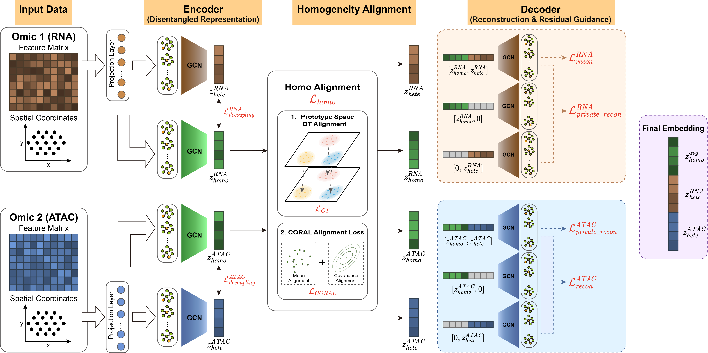

# SIMPLEOmics

A spatial multi-omics integration framework that unifies paired and diagonal integration through shared representation alignment.

## Overview



SIMPLEOmics integrates spatial multi-omics data by disentangling, aligning and reconstructing shared and omic-specific representations. Using RNA and ATAC as an example, omic-specific projection layers and graph convolutional networks (GCNs) learn homogeneous (shared) and heterogeneous (private) representations, with a decoupling constraint promoting their separation. The homogeneous representations are further aligned across omics through prototype-based optimal transport (OT) and correlation alignment (CORAL). Residual-guided reconstruction encourages private representations to capture complementary information unexplained by the shared component. Finally, the aligned homogeneous and omic-specific representations are combined to generate the integrated embedding for downstream analysis.

## Installation

We recommend using [Conda](https://docs.conda.io/) to create an environment for SIMPLEOmics.

### Option 1: Install using Conda (Recommended)

Clone the SIMPLEOmics repository:

```bash
git clone https://github.com/ZhuLab-Fudan/SIMPLEOmics.git
cd SIMPLEOmics
```

Create and activate the Conda environment using the provided `environment.yml` file:

```bash
conda env create -f environment.yml
conda activate SIMPLEOmics_env
```

This installs the dependencies specified in the environment configuration.

### Option 2: Install using pip

Alternatively, users can create a Python environment and install the required Python packages using `requirements.txt`:

```bash
conda create -n SIMPLEOmics_env python=3.8
conda activate SIMPLEOmics_env

pip install -r requirements.txt
```

**Note:** The pip-based installation does not automatically configure the R environment required for mclust clustering. Users must install R and the corresponding R package separately.

### R dependencies

SIMPLEOmics uses the R package `mclust` for model-based clustering through the Python package `rpy2`.

If `mclust` is not already installed, it can be installed by running:

```bash
R -e 'install.packages("mclust", repos="https://cloud.r-project.org")'
```

Alternatively, it can be installed using Conda:

```bash
conda install -c conda-forge r-mclust
```

Ensure that the R installation used by `rpy2` can access the `mclust` package.


## Tutorials

Please find examples of SIMPLEOmics applications in the tutorials folder, where jupyter notebooks are provided.
- **simulation_tutorial:** Using SIMPLEOmics to integrate simulated spatial RNA-ATAC data
- **rna_metabolite_tutorial:** Using SIMPLEOmics to integrate paired spatial transcriptomics and metabolomics data from a 6-OHDA-induced mouse model of Parkinson's disease
- **atac_multi_tutorial:** Using SIMPLEOmics to integrate multi-slice spatial RNA-ATAC data of mouse brain
- **atac_diag_tutorial:** Using SIMPLEOmics to integrate RNA data from E15 mouse brain and ATAC data from E18 mouse brain (diagnal integration)

**NOTE:** Please update the data paths before running the code.

## Datasets

All datasets used in this study are publicly available. The MISAR-seq mouse brain data can be accessed from National Genomics Data Center with accession number OEP003285: https://www.ncbi.nlm.nih.gov/geo/query/acc.cgi?acc=GSE263617. The combined spatial RNA and metabolite data for the mouse brain are available at Mendeley Data under accession code(https://doi.org/10.17632/w7nw4km7xd.1). These datasets required to reproduce the analyses presented in our paper can also be accessed through the **data_SIMPLEOmics/** directory of this repository.

## Contacts and bug reports

Please feel free to send bug reports or questions to Yanzhe Lv: 23110850008@m.fudan.edu.cn and Prof. Shanfeng Zhu: zhusf@fudan.edu.cn
